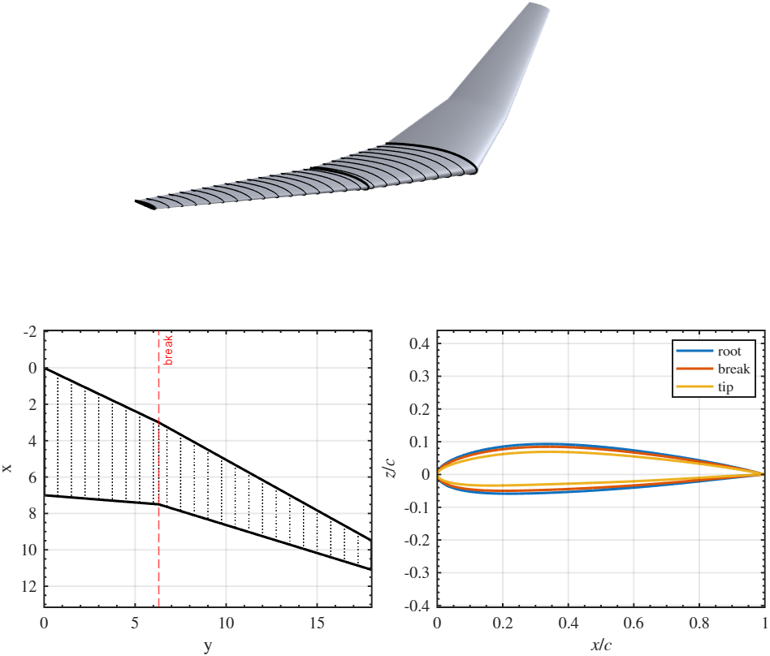
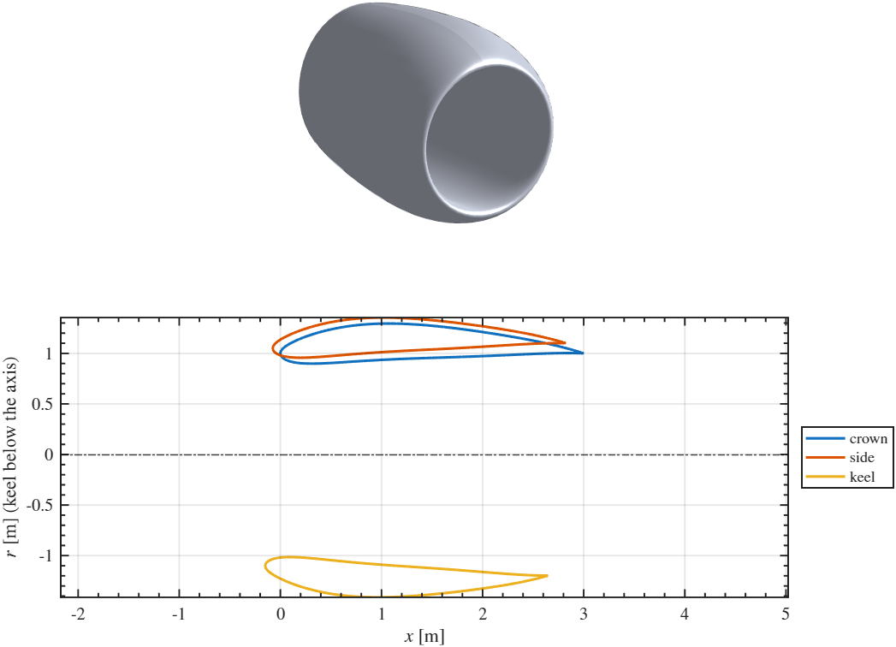
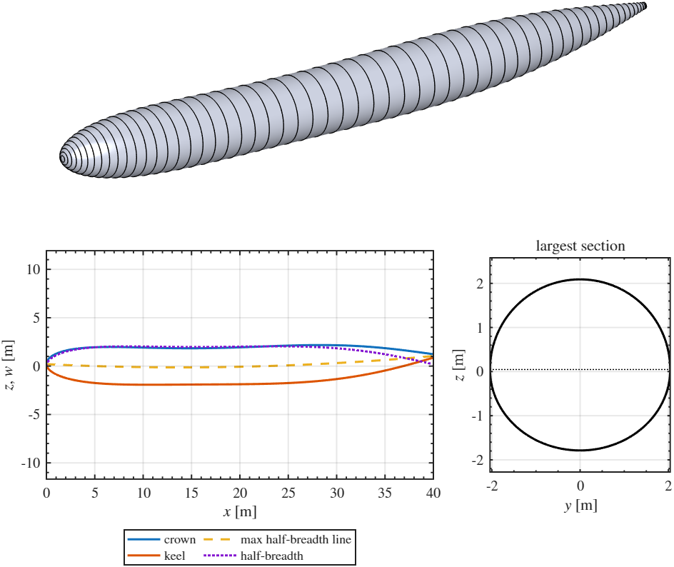
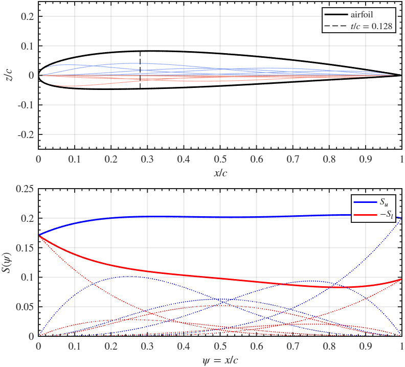
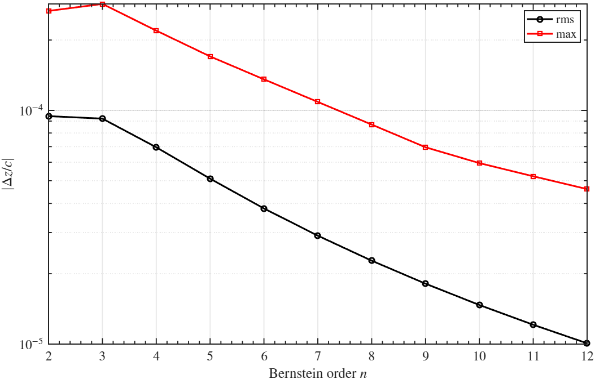
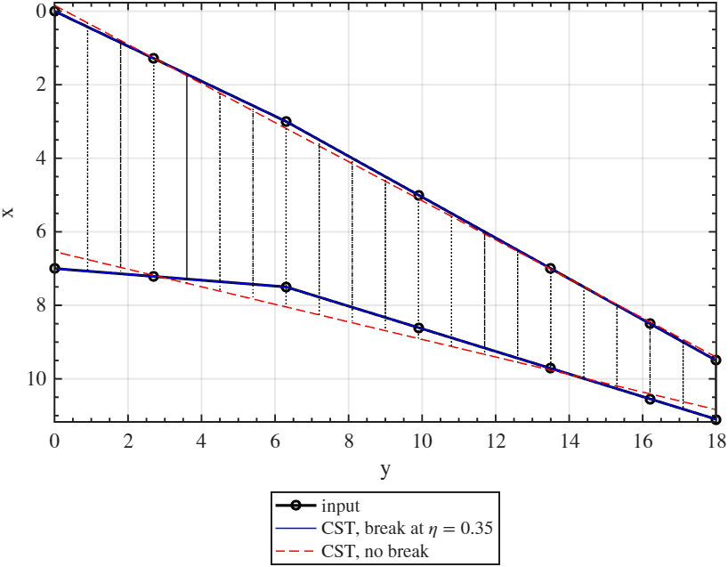

# matlab_cst — CST parametrization of airfoils, wings, nacelles and fuselages

MATLAB functions to describe aircraft shapes with the Class function / Shape function Transformation (CST) of Kulfan, in both directions:

- **build**: CST parameters → geometry (`CST2Airfoil`, `CST2Wing`, `CST2Nacelle`, `CST2Fuselage`)
- **fit**: geometry → CST parameters (`Airfoil2CST`, `Wing2CST`, `Nacelle2CST`, `Fuselage2CST`)

The geometry in the physical domain is always an object of a class (`Airfoil_class`, `Wing3D_class`, `Nacelle_class`, `Fuselage_class`), in the style of NUIST's `Wing_class`. The CST parameters are plain structs with the field names of RASO / WiMOT / NUIST (`Au`, `Al`, `dzu`, `dzl`, `n`, `N1`, `N2`, ...).

The scope follows [cst-modeling3d](https://github.com/swayli94/cst-modeling3d) (Python); the mathematics follows Kulfan (2008), referenced by equation number in the code.

<table>
  <tr>
    <td width="50%"></td>
    <td width="50%"></td>
  </tr>
  <tr>
    <td align="center"><b>Wing</b> with a planform break: 3D surface, planform, root/break/tip airfoils</td>
    <td align="center"><b>Nacelle</b>: crown, side and keel profiles, smooth all around</td>
  </tr>
  <tr>
    <td width="50%"></td>
    <td width="50%"></td>
  </tr>
  <tr>
    <td align="center"><b>Fuselage</b>: crown, keel and half-breadth lines, cross sections</td>
    <td align="center"><b>Airfoil</b>: component airfoils and shape functions $S_u$, $S_l$</td>
  </tr>
</table>

*Output of the `examples/build_*.m` live scripts: every CST parameter is a slider and the figure follows it.*

```matlab
addpath src
AF   = Airfoil_class('examples/data/naca0012.dat');    % physical domain
CST  = Airfoil2CST(AF,n=6);                             % fit
AF2  = CST2Airfoil(CST);                                % build

W    = Wing3D_class(eta,b,c,twist,Airfoil,Xle=Xle,Zle=Zle,eta_breaks=0.35);
CSTw = Wing2CST(W);                                     % spanwise CST, piecewise at the break
W2   = CST2Wing(CSTw,eta=linspace(0,1,41));
W2.plot(mirror=true); writeTecplot('wing.dat',W2.surface());
```

## Contents
- [The method](#the-method-kulfan-2008)
- [How to install](#how-to-install)
- [Shapes, classes and functions](#shapes-classes-and-functions)
- [Conventions](#conventions)
- [Wings with breaks](#wings-with-breaks)
- [Function reference](#function-reference)
- [Examples](#examples) · [Tests](#tests)
- [Relation to RASO, WiMOT, NUIST, WING2CATIA](#relation-to-raso-wimot-nuist-wing2catia)
- [Known limitations](#known-limitations)

## The method (Kulfan 2008)

**Airfoil.** With $\psi = x/c$ and $\zeta = z/c$, each side of an airfoil is (Eq. 7, 17, 19)

$$\zeta(\psi) = C(\psi)\,S(\psi) + \psi\,\Delta\zeta_{TE}, \qquad C(\psi) = \psi^{N_1}(1-\psi)^{N_2}, \qquad S(\psi) = \sum_{r=0}^{n} A_r\,K_r\,\psi^r(1-\psi)^{n-r}$$

- the **class function** $C$ fixes the family: $N_1 = 0.5,\ N_2 = 1$ round nose and sharp trailing edge, $0.5,\ 0.5$ ellipse, $1,\ 1$ biconvex, $0.75,\ 0.75$ Sears–Haack (`classFunction`);
- the **shape function** $S$ is a Bernstein polynomial of order $n$ (`bernsteinBasis`): the $n+1$ terms sum to one, so each coefficient scales one "component airfoil";
- $A_0 = \sqrt{2 r_{LE}/c}$ sets the leading edge radius, $A_n = \tan\beta + \Delta\zeta_{TE}$ the boat-tail angle (Eq. 4–5); the others shape the airfoil in between;
- from $n \approx 6$ the CST airfoil is within wind tunnel tolerance of the original (Sec. VII).

For fixed $N_1, N_2$ the airfoil is **linear** in $[A_u; A_l; \Delta\zeta_u; \Delta\zeta_l]$, so `Airfoil2CST` is a linear least squares fit (backslash): unique solution, no initial guess, no optimizer, no toolbox. With `LEcontinuity=true` (default) $A_{l,0} = -A_{u,0}$ (same nose radius on both sides).

<p align="center"><br>
<i>Fit error of NACA 0012 against the Bernstein order n (<code>examples/fit_airfoil.m</code>).</i></p>

**Wing.** Every chordwise coefficient is a Bernstein polynomial along the span $\eta = y/b$ (Sec. XII, Eq. 43–48),

$$A_{u,i}(\eta) = \sum_j B_{u,ij}\,S_{y,j}(\eta),$$

and so is every planform quantity: chord, twist, leading edge position, trailing edge thickness. This is Kulfan's *scalar loft*: the whole wing is a few control values (`Bu`, `Bl`, `c`, `twist`, `Xle`, `Zle`). Planform breaks make the polynomials piecewise ([below](#wings-with-breaks)).

**Nacelle.** Kulfan Sec. X, option 1: airfoil-type profiles in the meridional planes (crown, side, keel, ...), distributed around the axis. The profiles are handled exactly as wing sections, with the meridional angle $\varphi$ in place of the span, through $t = (1-\cos\varphi)/2$: a function of $\cos\varphi$ is even about the crown and the keel, so the surface is smooth across the symmetry plane whatever the coefficients. One profile = axisymmetric nacelle.

**Fuselage.** Sec. VIII–IX: each cross section is an upper and a lower lobe, $z = z_m \pm h\,(1-\eta^2)^{N}$ with $y = w\,\eta$ ($N = 0.5$ ellipse, $N \to 0$ rectangle, $N = 1$ parabola). Along $\psi = x/L$ the lobe heights $h_U, h_L$ and the half-breadth $w$ are CST curves closed at the nose ($N_1 = 0.5$: round nose; $\Delta\zeta$ = tail size), while the line of maximum half-breadth $z_m$ (upswept tail) and the lobe exponents $N_U, N_L$ are plain Bernstein polynomials. Everything is again linear.

## How to install
1. **MATLAB** R2022b or later (`arguments` blocks). **No toolbox** is needed: the fits use backslash, `fminbnd` and `spline`.
2. The **build live scripts with sliders** (`examples/build_*.m`) are in the plain-text Live Code format: they need **R2025a or later**. In older releases they still run as normal scripts, the sliders become plain assignments.
3. Clone the repository and `addpath src` (the examples do it with a relative path, run them from `examples/`).
4. Check: `runtests('tests')`.

## Shapes, classes and functions

| shape | physical domain (class) | fit | build | spanwise / longitudinal coordinate |
|---|---|---|---|---|
| airfoil | `Airfoil_class(x,z)` | `Airfoil2CST` | `CST2Airfoil` | — |
| wing | `Wing3D_class(eta,b,c,twist,Airfoil,Xle=,Zle=)` | `Wing2CST` | `CST2Wing` | $\eta = y/b$, piecewise at `eta_breaks` |
| nacelle | `Nacelle_class(phi,Rle,c,twist,Airfoil,Xle=)` | `Nacelle2CST` | `CST2Nacelle` | $t = (1-\cos\varphi)/2$ |
| fuselage | `Fuselage_class(x,zc,zk,w,zm=,NU=,NL=)` | `Fuselage2CST` | `CST2Fuselage` | $\psi = x/L$ |

Every class has `check`, `surface` (structured grids, see `writeTecplot`) and `plot`. Geometry from a CAD model: `Wing3D_class.fromSections(Y,XZ)` and `Fuselage_class.fromSections(x,Ysec,Zsec)` take cross-section point clouds.

**CST structs** (field names as in RASO/WiMOT/NUIST):

| shape | fields |
|---|---|
| airfoil | `Au`, `Al` ((n+1)×1), `dzu`, `dzl`, `n`, `N1`, `N2` (+ `rLE`, `err`, `AF` from the fit) |
| wing | `b`, `b0`, `eta_breaks`, `nx`, `ny`, `ny_plan`, `N1`, `N2`, `twist_axis`, `Bu`, `Bl` ((Nseg·ny+1)×(nx+1)), `c`, `twist`, `Xle`, `Zle`, `dzu`, `dzl` ((Nseg·ny_plan+1)×1) |
| nacelle | as the wing, with `Rle` and without `b`, `Zle`; rows from crown to keel |
| fuselage | `x0`, `L`, `N1`, `N2`, `Ahu`, `Ahl`, `Aw`, `dzhu`, `dzhl`, `dzw`, `Bzm`, `BNU`, `BNL` |

A CST written by hand needs only the essential fields, the builders fill the rest (e.g. a wing needs `b`, `Bu`, `Bl`, `c`; see the `build_*` live scripts).

## Conventions
- **Axes**: x aft, y spanwise (root to tip) or to the side, z up. Lengths in m, angles in **rad** (as NUIST and WING2CATIA).
- **Airfoils** in Selig order (TE → upper side → LE → lower side → TE); Lednicer files are read too. `normalize` puts the LE (farthest point from the TE, on a spline of the contour as in XFOIL) at (0,0) and the TE midpoint at (1,0).
- **Twist** positive nose up, rotation about x/c = `twist_axis` (0.25 for wings, as WiMOT and WING2CATIA; 0 = the highlight for nacelles, positive = lip outward). `Xle`, `Zle` are the leading edge of the *untwisted* section.
- **Wing sections** lie in the planes y = const (no rotation by the dihedral).
- **Nacelle** axis is y = z = 0; $\varphi = 0$ crown (top), $\pi/2$ side (+y), $\pi$ keel; profiles in $[0,\pi]$, mirrored about y = 0. Upper side of the profile airfoil = outer cowl.
- **Fuselage** symmetric about y = 0; stations from the nose.
- Wing/nacelle fits first **normalize** the section airfoils and move the residual chord, rotation and LE shift into `c`, `twist`, `Xle`, `Zle` (`normalizeSections`): the physical wing does not change.

## Wings with breaks
The question was whether wings with planform breaks (crank, kink of the leading or trailing edge) are worth including, given the extra input. They are, at the cost of **one vector**:

- **how**: the span is cut at `eta_breaks` into segments; in each segment every quantity is a Bernstein polynomial of order `ny` (airfoil coefficients) or `ny_plan` (planform) in the local coordinate. A Bernstein polynomial equals its first and last control value at the ends, so consecutive segments **share** the control value at the break: the geometry is continuous there and its slope can jump (`spanwiseBasis`). This is Kulfan's observation (Sec. XIII, Fig. 40) that the spanwise coefficients of real wings are "piecewise continuous between planform breaks".
- **input**: `Wing3D_class(...,eta_breaks=0.35)` (a break should also be a section), or `Wing2CST(W,eta_breaks=...)`. Nothing else changes.
- **readability**: with the default `ny_plan = 1` (straight leading and trailing edge, linear twist in each panel) the planform control values *are* the values at the root, at each break and at the tip, e.g. `CST.c = [c_root; c_break; c_tip]`.
- **cost**: `Nseg·ny + 1` control values per coefficient instead of `ny + 1`. Each segment needs at least `ny + 1` sections; `Wing2CST` chooses `ny` automatically (up to 3) when not given and stops with a clear message otherwise.
- **effect**: in `examples/fit_wing.m` the cranked planform is recovered to 1e-5 m with the break and with errors of 0.36 m in chord and 0.19 m in Xle without it.

<p align="center"><br>
<i>Cranked planform fitted with the break (blue, on the input) and without it (red dashed) (<code>examples/fit_wing.m</code>).</i></p>

## Function reference
`help <name>` gives the full description of each one.

| group | function | what it does |
|---|---|---|
| core | `classFunction` | $C(\psi) = \psi^{N_1}(1-\psi)^{N_2}$ |
| | `bernsteinBasis` | Bernstein polynomials of order n, one per column |
| | `cstCurve` | one CST curve $C\,S + \psi\,\Delta\zeta$ |
| | `fitCstCurve` | linear least squares of one CST curve |
| | `spanwiseBasis` | piecewise Bernstein basis with breaks |
| | `fitSpanwise` | control values of a spanwise distribution (automatic order) |
| | `sectionCST` | airfoil CST of the sections of a wing / nacelle CST |
| | `cosineSpacing`, `rotateSection` | point distribution, nose-up rotation |
| airfoil | `Airfoil_class` | points, file I/O, `naca4`, `split`, `leadingEdge`, `normalize`, `resample`, `thickness`, `plot`, `write` |
| | `Airfoil2CST`, `CST2Airfoil` | fit, build |
| wing | `Wing3D_class` | sections, LE position or sweep/dihedral, breaks, `S`, `mac`, `AR`, `surface`, `plot`, `plotPlanform`, `fromSections` |
| | `Wing2CST`, `CST2Wing` | fit, build |
| nacelle | `Nacelle_class` | meridional profiles, `profile`, `surface`, `plot`, `plotProfiles` |
| | `Nacelle2CST`, `CST2Nacelle` | fit, build |
| fuselage | `Fuselage_class` | lines and lobe exponents, `section`, `surface`, `plot`, `plotLines`, `fromSections` |
| | `Fuselage2CST`, `CST2Fuselage` | fit, build |
| shared | `fitSections`, `sectionError`, `normalizeSections`, `toAirfoilCell` | steps shared by wing and nacelle |
| output | `plotSurface`, `writeTecplot` | 3D plot, ASCII Tecplot (ordered zones) |

## Examples
In `examples/` (see its [README](examples/README.md)): `build_*.m` are live scripts with a slider for every CST parameter, the geometry is rebuilt at each change; `fit_*.m` define a geometry in the physical domain, fit it and compare.

## Tests
`runtests('tests')`: 21 tests, round trips CST → geometry → CST (exact), fit accuracy, normalization, breaks, file formats. See [tests/README.md](tests/README.md).

## Relation to RASO, WiMOT, NUIST, WING2CATIA
- **Same CST struct.** `Airfoil2CST` returns `Au`, `Al`, `dzu`, `dzl`, `n`, `N1`, `N2` with the meaning of `Foil2CST` / `WiMOT_Foil2CST`.
- **What changed** with respect to `Foil2CST` / `CST2Foil`:
  - the fit is linear least squares (no `lsqnonlin`, no Optimization Toolbox, no initial guess);
  - optional LE continuity $A_{l,0} = -A_{u,0}$ and normalization of the airfoil;
  - the two sides are split at the LE on a spline and each side is evaluated on its own points: `CST2Foil(psi,...)` pairs the x of one side with the coefficients of the other, which is exact only when both sides have the same x distribution.
- **No shadowing**: every name differs from the RASO/WiMOT/NUIST ones (`Airfoil2CST` vs `Foil2CST`, `Wing3D_class` vs `Wing_class`), so the repositories can be on the path together.
- **NUIST strips** from a wing CST (NUIST assumes a straight unswept LE, so `Xle`, `Zle` are not passed):
  ```matlab
  eta_s = linspace(0.01,0.99,20)';
  Ws    = CST2Wing(CST,eta=eta_s);               % the breaks are added as sections
  k     = ismember(Ws.eta,eta_s);
  Wing  = Wing_class(Ws.eta(k),Ws.b,Ws.c(k),Ws.twist(k), ...
                     cellfun(@(a) [a.x a.z],Ws.Airfoil(k),'UniformOutput',false));
  ```
- **CATIA** through WING2CATIA (same twist axis 0.25; sections in y = const planes, so no dihedral rotation):
  ```matlab
  AF  = cellfun(@(a) struct('x',a.x,'z',a.z),W.Airfoil,'UniformOutput',false);
  opt = WING2CATIA_option(); opt.SetDihedralRotation = false;
  WING2CATIA('wing',W.Xle,W.Yle,W.Zle,W.c,W.twist,AF,opt)
  ```

## Known limitations
- Wing sections are in y = const planes: vertical winglets and fins would need a curvilinear spanwise coordinate. No tip closure surface.
- The breaks are shared by the airfoil coefficients and the planform; only C0 continuity is imposed at a break.
- Nacelle: symmetric about y = 0, no spinner or core cowl; the inlet throat is not constrained to be circular.
- Fuselage: left/right symmetric sections; one class function along the whole body, so a long constant section needs a high order (`fit_fuselage.m`: 1.2 cm error on a 2 m radius with n = 12). Wing–body junctions are not handled.
- The fits minimize the z (or r, h, w) error at the given points, without weights.
- Output: ASCII Tecplot and Selig `.dat`; no IGES/STEP (CATIA via WING2CATIA).

## Tested versions
| software | version |
|---|---|
| MATLAB | R2025a (25.1.0.2943329), Windows |

## References
- B. M. Kulfan, *Universal Parametric Geometry Representation Method*, Journal of Aircraft 45(1), 142–158, 2008. [doi:10.2514/1.29958](https://doi.org/10.2514/1.29958)
- R. Li, *cst-modeling3d*, [github.com/swayli94/cst-modeling3d](https://github.com/swayli94/cst-modeling3d) (Python, MIT).

## License
MIT, see [LICENSE](LICENSE). Author: Emanuele Sticchi.
